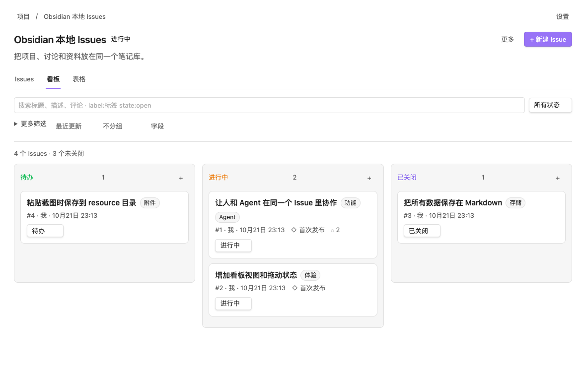
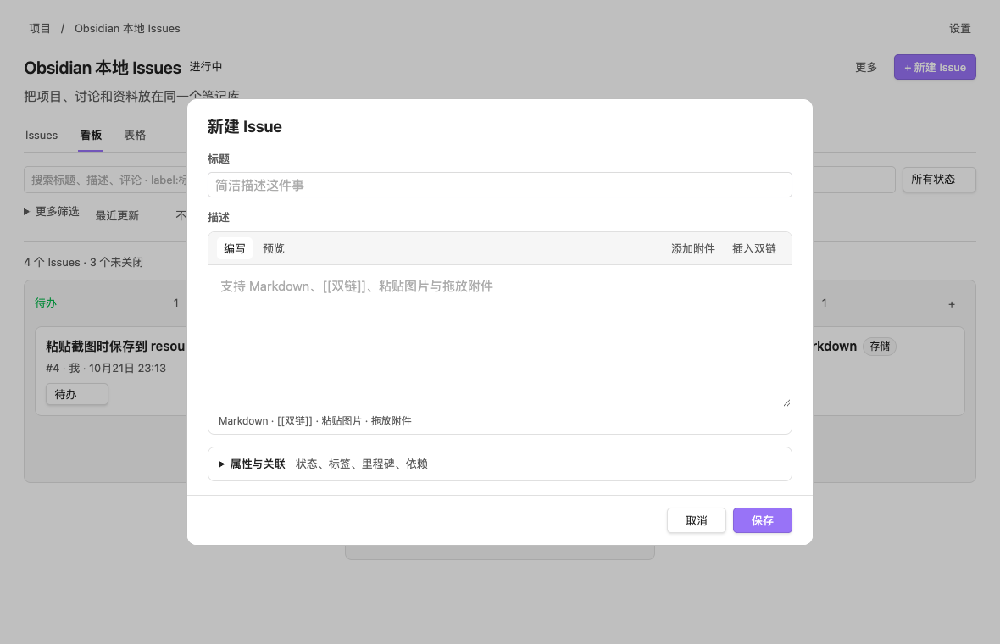

# Local Issues

[中文说明](README.zh-CN.md)

GitHub Issues-style project tracking inside an Obsidian vault. Organize projects, issues and ongoing discussions as local Markdown files that remain readable without the plugin.

**Desktop, iOS and Android · Obsidian 1.14.4+ · Interface language: Simplified Chinese · MIT license**

- Multiple projects with progress, search, filters, sorting and grouping.
- Issue lists, Kanban boards and tables, with labels, milestones, assignees and due dates.
- Parent issues, sub-issues and dependencies.
- Markdown descriptions and editable comments, with chronological status history.
- Native Obsidian links, hyperlinks, attachments, pasted images and dropped files.
- An optional loopback API and a separate agent CLI with familiar `gh`-style commands and JSON output.
- Semantic links open a local web interface for creating and editing projects/issues, inline Markdown editing and previews, comments, close reasons, attachments, relations and bulk updates. Lists default to open issues and support search, filters, sorting, grouping, board and table views. Drag cards to change state. The web interface and Obsidian share the same Markdown files and revision checks, with no polling or external dependencies at runtime. Note embeds, heading/block references and advanced Obsidian rendering open in Obsidian.
- `/llms.txt` provides the agent bootstrap (including how to save the skill; web pages do not show it) and `/api/cli.mjs` downloads the installed standalone CLI (Node.js 22+).
- Revision checks and atomic writes protect edits made directly in your notes.





## Install

Download `local-issues.zip` from [Releases](https://github.com/xinxinrana/obsidian-local-issues/releases/latest), extract the `local-issues` folder into `<vault>/<config-directory>/plugins/`, and enable **Local Issues** in Obsidian's Community plugins settings. The default configuration directory is `.obsidian`.

Alternatively, place `main.js`, `manifest.json` and `styles.css` from the same release into that plugin folder. The CLI is optional and distributed separately as `cli.mjs`; the complete ZIP includes it.

Open the ribbon button **Local Issues：项目**, or run **Local Issues：打开项目** in the command palette. Create a project, then create its first issue. The **更多** menus contain note actions and, on desktop, sharing actions. In the issue editor, expand **属性与关联** to set labels, milestones, assignees and relationships.

Project descriptions, issue bodies and comments share a live Markdown editor in Obsidian and the browser. Headings, quotes, task items, inline formatting and local images render in place. Use `Cmd/Ctrl+B` for bold, `Cmd/Ctrl+I` for italic, `Cmd/Ctrl+K` for a link, and `Cmd/Ctrl+/` for source mode. Switching modes preserves selection and undo history. `Tab` and `Shift+Tab` indent lists and otherwise keep normal focus navigation. `Cmd/Ctrl+Enter` submits; `Cmd/Ctrl+Shift+U` selects attachments. Tables remain editable as source. Create a project before adding attachments.

On Mac, swipe right with two fingers to go back or left to go forward inside Local Issues, using Obsidian's native page history. The **触控板双指导航** setting includes a toggle and animated directions. You can also assign hotkeys to **返回上一页** and **前进下一页** in Obsidian.

On phones, the navigation and primary actions stay in place while lists and conversations scroll inside the page. Search stays compact, with sorting, grouping and view options behind **筛选**. Projects use a card layout and issue properties collapse above the conversation. Create and edit projects, issues and comments, change status and select attachments inside Obsidian. Creating and editing opens a focused page with Cancel and Save at the top; the editor offers Write, Preview and Attachments and adapts to the on-screen keyboard. Sharing, Agent commands, the CLI and the local API are desktop features and are hidden on phones. Data stays in the same vault and follows its existing sync setup.

In Obsidian, create and edit forms cache each input on the current device. Reopen the corresponding form after switching notes, closing a view or restarting to continue its draft, including raw Markdown, unfinished fields and attachment references. A successful save or comment submission clears that draft; failed saves and revision conflicts preserve it. Reopening Local Issues resumes the latest unfinished edit; **草稿** in the navigation lists recoverable inputs. An immediate device-local journal and separate files in the plugin’s `drafts/` directory preserve drafts independently of Obsidian view history and autosave. Device files are separate, and the backups can follow the plugin directory’s sync setup.

## Agent CLI

The CLI requires Node.js 22+ and a running desktop Obsidian instance with Local Issues enabled.

1. Open the Local Issues settings. The complete ZIP includes `cli.mjs`; other installations can download it through **安装 CLI**.
2. Enable **本地 Agent API** in plugin settings. It is disabled by default on a new installation.
3. Click **安装 CLI** in settings. The installer checks Node.js 22+, reuses the bundled CLI or downloads the matching release with SHA-256 verification, installs `local-issues` in `~/.local/bin`, configures your user PATH and verifies the command. Reopen your terminal to use it. Failures show the current step and a relevant recovery action. The command uses `--vault`, so port changes need no reinstall.
4. **复制引导语** copies a short hand-off telling the agent to save the skill into its own skills directory; **复制 Skill** copies `SKILL.md` only. Agents can also run `local-issues skill` (or `local-issues skill --dir <dir>`).

Without the command, use `node '/path/to/plugin/cli.mjs' --vault "/path/to/vault" --help`.

**复制引导语** provides the agent hand-off; **复制 Skill** provides the standalone skill contents.

The default configuration directory is `.obsidian`. The CLI currently expects that default directory when locating a vault's API settings.

For bash or zsh, define a convenience function after installing the CLI in the plugin folder:

```sh
local-issues() { node '/path/to/vault/.obsidian/plugins/local-issues/cli.mjs' "$@"; }

local-issues project create -t 'My project'
local-issues issue create -P 'My project' -t 'Support pasted images' -b 'See [[Design]]'
local-issues issue list -P 'My project' --state all --json number,title,status
local-issues issue view 1 -P 'My project' --json
local-issues issue comment 1 -P 'My project' -b 'Agent progress update' --author Agent
local-issues issue edit 1 -P 'My project' --label feature --milestone 'First release'
local-issues issue attach 1 -P 'My project' ./screenshot.png
local-issues issue close 1 -P 'My project'
local-issues issue reopen 1 -P 'My project'
```

`--body-file file.md` reads Markdown from a file; `--body-file -` reads standard input. Use project-scoped numbers, stable IDs or full Obsidian links to identify issues. `--if-match <revision>` rejects a stale edit; read the current revision with `issue view --json` first.

Choose **分享给 Agent** to copy a readable resource URL, such as:

```text
http://localhost:27183/
http://localhost:27183/local-issues
http://localhost:27183/local-issues/issues?state=open
http://localhost:27183/local-issues/issues/5
```

The repository is the current vault. Project URL names remain stable after title edits. **复制 Issues 列表链接** preserves the current list filters. Links contain no executable commands or credentials. No login or keys are required.

```sh
local-issues view '<resource URL>' --json
local-issues repo view '<repo URL>' --json
local-issues project view '<project URL>' --json
local-issues issue list '<issues list URL>' --json
local-issues issue view '<issue URL>' --comments
local-issues issue edit '<issue URL>' --body-file description.md --if-match '<revision>'
local-issues issue comment '<issue URL>' --body-file reply.md
local-issues issue close '<issue URL>'
local-issues issue reopen '<issue URL>'
```

The settings installer installs the `local-issues` command; `npm install -g .` from the source directory also works, including on Windows. `local-issues view` infers the target type; `-P` accepts a project title, folder name or the project name from a link. Replace `local-issues` with `node '/absolute/path/cli.mjs' --vault '/path/to/vault'` if needed. Existing legacy share URLs and `local-issues share ...` commands remain compatible. See the [link and CLI guide](docs/agent-cli.zh-CN.md).

## Local data and privacy

Projects, issues, comments and status events live in `Local Issues/` by default. Each project has a `project.md` file, an `issues/` folder and a `timeline/` folder. Images and attachments are stored in `resource/local-issues/`. You can read and edit these Markdown files with Obsidian or another editor. Preserve their `id`, `type`, `projectId` and `issueId` properties. Issue states are `open` and `closed`; `closeReason` is `completed`, `on-hold`, or `not-planned`. Legacy `in-progress` is read as open.

No account, subscription, payment or remote service is required. There is no telemetry. Normal project operations use no external services; clicking **安装 CLI** may download the matching CLI and checksum file from GitHub. Its optional HTTP server binds only to `127.0.0.1`, on port `27183` by default. CLI requests are restricted to loopback HTTP addresses. The local API requires no credentials and rejects browser cross-origin requests.

Resource links identify local data. They work only on the computer running Obsidian; the local CLI can read and modify the active vault.

Project data stays inside the vault. The separate CLI reads its settings from the vault and reads attachment or body files outside the vault **only when you explicitly pass their paths**. CLI installation starts only when you click **安装 CLI**. It writes a user-local launcher and, where necessary, a marked shell PATH block (or the Windows user PATH). Uninstall removes its managed launcher and PATH changes while retaining the plugin CLI asset and unrelated user configuration. Existing commands owned by other tools or vaults are never overwritten. The plugin does not install commands on startup or install Node.js automatically; missing Node.js produces a download link and an optional executable-path field.

## Develop

```sh
npm ci
npm run build
npm test
```

For the mobile layout checks in headless WebKit, run `npx playwright install webkit` once, then `npm run test:mobile`. These checks cover portrait and landscape layouts, touch targets and reduced viewport height with the keyboard open.

The build produces `main.js` and `cli.mjs`. Tests use temporary data and mocked Obsidian components; they do not access your vault. Release tags exactly match `manifest.json` versions, without a `v` prefix. Upload `main.js`, `manifest.json` and `styles.css` to each GitHub release; attach `cli.mjs` and the complete ZIP for CLI and manual installations.

## License and support

[MIT](LICENSE). Bundled `yaml` uses the ISC license and `@noble/hashes` uses the MIT license; see [third-party notices](THIRD_PARTY_NOTICES.txt). Demo screenshots contain synthetic example data.

Report bugs and feature requests in [GitHub Issues](https://github.com/xinxinrana/obsidian-local-issues/issues).
