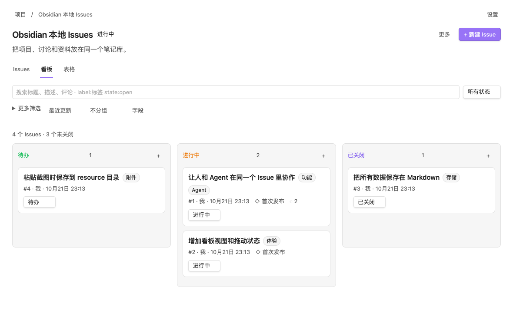
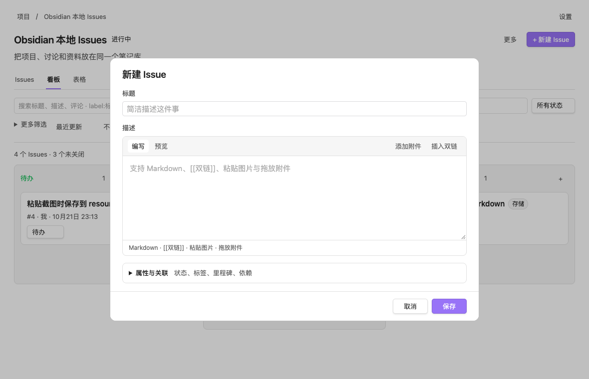

# Local Issues

[中文说明](README.zh-CN.md)

GitHub Issues-style project tracking inside an Obsidian vault. Organize projects, issues and ongoing discussions as local Markdown files that remain readable without the plugin.

**Desktop only · Obsidian 1.14.4+ · Interface language: Simplified Chinese · MIT license**

- Multiple projects with progress, search, filters, sorting and grouping.
- Issue lists, Kanban boards and tables, with labels, milestones, assignees and due dates.
- Parent issues, sub-issues and dependencies.
- Markdown descriptions and editable comments, with chronological status history.
- Native Obsidian links, hyperlinks, attachments, pasted images and dropped files.
- An optional loopback API and a separate agent CLI with familiar `gh`-style commands and JSON output.
- Revision checks and atomic writes protect edits made directly in your notes.





## Install

Download `local-issues.zip` from [Releases](https://github.com/xinxinrana/obsidian-local-issues/releases/latest), extract the `local-issues` folder into `<vault>/<config-directory>/plugins/`, and enable **Local Issues** in Obsidian's Community plugins settings. The default configuration directory is `.obsidian`.

Alternatively, place `main.js`, `manifest.json` and `styles.css` from the same release into that plugin folder. The CLI is optional and distributed separately as `cli.mjs`; the complete ZIP includes it.

Open the ribbon button **Local Issues：项目**, or run **Local Issues：打开项目** in the command palette. Create a project, then create its first issue. The **更多** menus contain note and sharing actions. In the issue editor, expand **属性与关联** to set labels, milestones, assignees and relationships.

## Agent CLI

The CLI requires Node.js 22+ and a running desktop Obsidian instance with Local Issues enabled.

1. Download `cli.mjs` from the same [release](https://github.com/xinxinrana/obsidian-local-issues/releases/latest). You can keep it anywhere and pass `--vault`, or put it in the plugin folder to use **复制 CLI 命令** in plugin settings.
2. Enable **本地 Agent API** in plugin settings. It is disabled by default on a new installation.
3. Run `node cli.mjs --vault "/path/to/vault" --help`.

The default configuration directory is `.obsidian`. The CLI currently expects that default directory when locating a vault's API settings.

For bash or zsh, define a convenience function after installing the CLI in the plugin folder:

```sh
li() { node '/path/to/vault/.obsidian/plugins/local-issues/cli.mjs' "$@"; }

li project create -t 'My project'
li issue create -P 'My project' -t 'Support pasted images' -b 'See [[Design]]'
li issue list -P 'My project' --state all --json number,title,status
li issue view 1 -P 'My project' --json
li issue comment 1 -P 'My project' -b 'Agent progress update' --author Agent
li issue edit 1 -P 'My project' --label feature --milestone 'First release'
li issue attach 1 -P 'My project' ./screenshot.png
li issue close 1 -P 'My project'
li issue reopen 1 -P 'My project'
```

`--body-file file.md` reads Markdown from a file; `--body-file -` reads standard input. Use project-scoped numbers, stable IDs or full Obsidian links to identify issues. `--if-match <revision>` rejects a stale edit; read the current revision with `issue view --json` first.

Copy a project or issue's **分享给 Agent** link from its **更多** menu, then read or edit the shared target from a local agent:

```sh
li share view '<share URL>' --json
li share edit '<share URL>' --body 'Updated description'
li share comment '<issue share URL>' --body 'Another comment'
li share comment-edit '<issue share URL>' '<comment ID>' --body 'Edited comment'
li resolve '[[Design]]' --json
```

## Local data and privacy

Projects, issues, comments and status events live in `Local Issues/` by default. Each project has a `project.md` file, an `issues/` folder and a `timeline/` folder. Images and attachments are stored in `resource/local-issues/`. You can read and edit these Markdown files with Obsidian or another editor. Preserve their `id`, `type`, `projectId` and `issueId` properties. Issue states are `open`, `in-progress` and `closed`.

No account, subscription, payment or remote service is required. There is no telemetry. The plugin makes no requests to external services. Its optional HTTP server binds only to `127.0.0.1`, on port `27183` by default. CLI requests are restricted to loopback HTTP addresses and use the API token in the plugin's local `data.json`.

Share URLs include a secret that grants read/write access to the shared target. They work only on the computer running Obsidian, and can be revoked in plugin settings. Do not post them publicly. API tokens and sharing secrets are kept in plugin settings, not in note content.

The plugin operates inside the vault. The separate CLI reads its settings from the vault and reads attachment or body files outside the vault **only when you explicitly pass their paths**. The plugin does not automatically download, install or update the CLI or other software. External links in settings open GitHub only when clicked.

## Develop

```sh
npm ci
npm run build
npm test
```

The build produces `main.js` and `cli.mjs`. Tests use temporary data and mocked Obsidian components; they do not access your vault. Release tags exactly match `manifest.json` versions, without a `v` prefix. Upload `main.js`, `manifest.json` and `styles.css` to each GitHub release; attach `cli.mjs` and the complete ZIP for CLI and manual installations.

## License and support

[MIT](LICENSE). Bundled `yaml` uses the ISC license; see [third-party notices](THIRD_PARTY_NOTICES.txt). Demo screenshots contain synthetic example data.

Report bugs and feature requests in [GitHub Issues](https://github.com/xinxinrana/obsidian-local-issues/issues).
